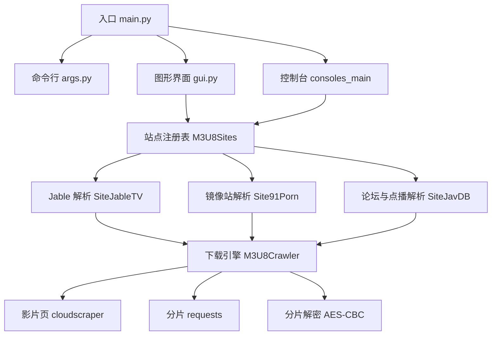

<!-- generated from: JableTV src @ 2026-10-11 -->

# JableTV 架构总览

## 总体功能

JableTV 从已注册站点的影片页取出标题、封面 URL 与 HLS 播放列表（m3u8），把分片下载到本地后拼接为一个 `.mp4`。

上游是站点 HTML 与 m3u8 服务器。下游是调用方指定的保存目录。控制台入口与图形界面共用同一套站点注册表和 `M3U8Crawler`。

## 构建环境

| 项 | 值 |
|----|-----|
| 语言 | Python 3（源码未声明最低版本；2026-10-11 在 CPython 3.14.3 上执行过入口） |
| 构建系统 | 无。直接 `python main.py` |
| 打包 | README 记载 Windows 可执行文件位于 `dist/`（该目录被 `.gitignore` 忽略，仓库内无产物） |
| 输出类型 | 脚本进程；图形界面为 Tk 窗口 |

依赖版本的唯一定义在 `requirements.txt`。下表是用途摘要。

| 包 | `requirements.txt` 版本 | 用途 |
|----|------------------------|------|
| requests | 2.25.1 | 下载 m3u8 密钥与 TS 分片 |
| beautifulsoup4 | 4.9.3 | 解析列表页 HTML |
| m3u8 | 0.8.0 | 解析播放列表与分片 URI |
| pycryptodome | 3.9.9 | AES-CBC 解密分片 |
| cloudscraper | 1.2.58 | 请求影片页 HTML |
| Pillow | ~=9.2.0 | 图形界面缩放封面 |

2026-10-11：在 CPython 3.14.3 上，`Pillow~=9.2.0` 构建 wheel 失败（`KeyError: '__version__'`）。其余五个包可以安装。本机该 Python 未编译 `_tkinter`，图形界面与 `main.py` 的导入因此失败。详见 [guides/download_video.md](guides/download_video.md)。

## 模块划分

| 模块 | 源码 | 职责 | 详细文档 |
|------|------|------|---------|
| entry | `main.py`, `args.py`, `config.py` | 解析命令行并选择控制台或图形界面 | [modules/entry.md](modules/entry.md) |
| crawler | `M3U8Sites/M3U8Crawler.py` | 拉播放列表、下载分片、解密、拼接 | [modules/crawler.md](modules/crawler.md) |
| sites | `M3U8Sites/__init__.py`, `M3U8Sites/SiteJableTV.py`, `M3U8Sites/Site91Porn.py`, `M3U8Sites/SiteJavDB.py` | 按 URL 选择站点并抽出 m3u8 | [modules/sites.md](modules/sites.md) |
| gui | `gui.py`, `mywidget.py` | 下载列表、封面预览、队列 | [modules/gui.md](modules/gui.md) |

## 总体架构

## 模块依赖关系

### 依赖关系表

| 模块 | 依赖 | 稳定性 | 备注 |
|------|------|--------|------|
| entry | gui, sites, config（经 args） | Stable | `main.py` 无条件 `import gui` |
| gui | sites, mywidget, Tk, Pillow | Internal | 下载动作调用 `CreateSite` |
| sites | crawler, cloudscraper, BeautifulSoup | Experimental | 选择器随站点 HTML 失效 |
| crawler | requests, m3u8, Crypto, config.headers | Internal | 不引用具体站点类 |
| config | 无 | Stable | 仅 `headers` 字典 |

### 依赖约束（三铁律）

1. **单向依赖**: 入口依赖界面与站点注册表；站点适配器依赖 `M3U8Crawler`；`M3U8Crawler` 不引用站点类。
2. **禁止跨层反向依赖**: 下载引擎不导入 `gui` 或 `main`。
3. **公共模块不得依赖业务模块**: `config.py` 不导入业务模块。`M3U8Crawler` 只依赖 `config.headers`。

**已知违规**: `main.py` 在判断 `--nogui` 之前执行 `from gui import *`。控制台路径因此依赖 Tk。2026-10-11 在未安装 `_tkinter` 的 CPython 3.14.3 上，`python main.py --nogui True` 于导入阶段退出，下载函数未被调用。

### 稳定性等级

| 等级 | 含义 | 本仓库中的对象 |
|------|------|----------------|
| Stable | 调用契约应保持 | `CreateSite`, `consoles_main`, `headers` |
| Internal | 进程内部实现 | `M3U8Crawler` 的下载步骤、图形界面控件 |
| Experimental | 站点页面一变即失效 | 各 `get_url_infos` 正则与 `siteList` 条目 |

## 关键设计决策

### 为什么按站点分子类，而不是一个通用解析器

**决策问题**: 各站把 m3u8 放在不同的 HTML 或接口字段里。
**选择理由**: 每个站点类只覆盖 `website_dirname_pattern` 与 `get_url_infos`。`VaildateUrl` 按 `siteList` 顺序返回第一个 `validate_url` 命中的类。
**权衡说明**: 新增站点要改注册表和子类。页面结构变化只破坏对应子类，下载与拼接仍在 `M3U8Crawler`。

### 为什么影片页用 cloudscraper，分片用 requests

**决策问题**: 影片页有反爬，分片 URL 数量大。
**选择理由**: `get_url_infos` 用 `cloudscraper.create_scraper(browser=request_headers, delay=10)`。分片与密钥用 `requests.get(..., headers=headers, timeout=10)`。`request_headers` 为 `{'browser': 'firefox', 'platform': <platform.system().lower()>}`。
**权衡说明**: 2026-10-11 对 `https://jable.tv/videos/start-153/`，cloudscraper 1.2.58 与 1.2.71 都收到 HTTP 403，响应头 `Cf-Mitigated: challenge`，HTML 标题为 `Just a moment...`。播放列表未被取出。分片下载因此没有开始。

### 为什么自行拼接 TS，而不调用 ffmpeg

**决策问题**: 加密 HLS 需要密钥与按序拼接。
**选择理由**: `_create_m3u8` 读取播放列表与 `#EXT-X-KEY`，`_scrape` 在写入前用 AES-CBC 解密，`_mergeMp4Chunks` 按分片顺序把字节追加到目标 `.mp4`。
**权衡说明**: 无 ffmpeg 依赖。绝对 `https://` 分片 URI 的赋值被注释掉；初始化向量取十六进制字符串前 16 个字符的 ASCII，而不是 16 字节解码结果。这两处会使拼接结果不可播放。详见 [modules/crawler.md](modules/crawler.md)。

### 为什么图形界面串行影片、分片并行

**决策问题**: 同时下多部影片会占满连接，同时下部分片才能缩短一部影片的时间。
**选择理由**: `JableTVDownloadWindow` 同时只持有一个 `_currentJob`。分片使用 `ThreadPoolExecutor`，`max_workers` 为 `cpu_count()`（当该值大于 8）否则为 8。
**权衡说明**: 队列里其余 URL 状态为 `等待中`。取消当前任务要等线程池 `shutdown`。

## 重要信息

2026-10-11 对 `https://jable.tv/videos/start-153/` 的实测：

| 调用 | 结果 |
|------|------|
| `python main.py --url <该 URL> --nogui True` | `ModuleNotFoundError: No module named '_tkinter'`，进程退出码 1 |
| `M3U8Sites.consoles_main` 同一 URL | 打印 `下載網址 … 錯誤!!`。未创建保存目录，未写入 `.mp4` |
| 同一 URL 的 HTTP 响应 | 状态 403，`Server: cloudflare`，`Cf-Mitigated: challenge`，正文无 `og:title` 与 `.m3u8` |

`SiteJableTV.get_url_infos` 在状态码不是 200 时抛出 `Exception`。`M3U8Crawler.__init__` 捕获后把标题、封面、m3u8 都置空，并打印「下載網址錯誤」。调用方看到的现象与「URL 不匹配」相同。

## 版本记录

| 日期 | 作者 | AI 模型 | 内容 |
|------|------|---------|------|
| 2026-10-11 | xiangyu | Grok 4.7 | 初版。依据当时源码与 `start-153` 实测写入架构、依赖与失败点 |
